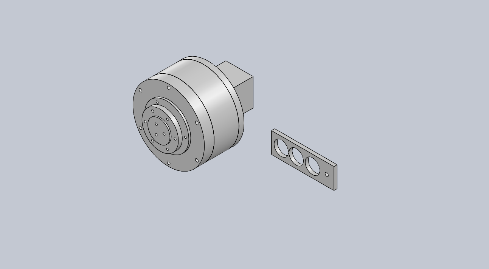

# Thenar actuator development

A 9:1 printed cycloidal bench demonstrator for the JK42HS48-1684 lab stepper, and a development plan for actuators suitable for the [Thenar JX1](https://github.com/nickthelegend/thenar-jx1) robot.

**Release R1 is for demo printing and engineering review. No physical prototype has been tested. It is not rated for 36 N·m and must not support the JX1 robot.**



## Open the model

- [STEP assembly](cad/demo-r1/THENAR-C9-DEMO-R1.step)
- [SolidWorks assembly and dependent parts](cad/demo-r1/solidworks/) — imported solid bodies, not reconstructed sketch features or a mated motion assembly.
- [Individual STL and STEP print files](cad/demo-r1/print/)
- [Print quantities and dimensions](cad/demo-r1/print-manifest.json)
- [Supplier package](releases/THENAR-C9-DEMO-R1-RFQ.zip)

The original geometry is parameterised in [build_demo.py](tools/build_demo.py). Ten fixed steel pins and a nine-lobe disc give a 9:1 reduction, with opposite output rotation. The nominal housing is 110 mm diameter; the complete motor-to-output envelope is about 124 mm long. This deliberately spacious demo does not fit the JX1 M-class 88 × 49 mm envelope.

The fit coupon is shown separately beside the assembly and is not installed. Purchased bearings, pins and motor are simplified reference envelopes; their internal geometry is not represented.

## Build and qualification documents

1. [JX1 requirements audit and actuator selection](docs/JX1-audit.md)
2. [Prototype assembly and hardware](docs/demo-build.md)
3. [Development plan, simulation and physical tests](docs/development-plan.md)
4. [Supplier printing request](rfq/PRINT-REQUEST.txt)
5. [Verification results](verification/geometry.json)

## Reproduce

Python dependencies: CadQuery, NumPy, trimesh, Shapely, PyYAML; pywin32 and an installed licensed SolidWorks for the native export. Install versions recorded in `verification/environment.json` in a virtual environment.

```powershell
python tools/build_demo.py
python tools/audit_jx1.py
python tools/save_solidworks.py
python tools/verify_solidworks.py
python tools/package_rfq.py
```

CAD checks measure solid validity, watertight STL meshes and sampled geometric clearances. They do not measure torque, efficiency, fatigue, temperature, backlash or physical backdrivability. The validation programme in `docs/development-plan.md` must be completed before selecting production hardware.

## Twenty units

The supplier request is for one demo set and a separate indicative quote for 20 identical print sets. Twenty is a proposed development batch, not a purchase commitment or the JX1 actuator count. JX1 currently specifies **21 main actuators of five classes plus two neck servos**. Freeze the joint-class allocation before ordering a robot batch.

The previous stator winding station and private supplier correspondence remain outside this repository. This release only contains the new gearbox development package and its supporting analysis.
